# Coffee POS: Architecture

How the Coffee POS is put together and how requests move through it. Endpoint contracts, validation rules and configuration are in [`SYSTEM_SPEC.md`](SYSTEM_SPEC.md); product requirements are in the PRD; coding rules are in `CLAUDE.md`.

## 1. Summary

Coffee POS is a **single-process monolith**: one Node.js process serves the web pages, the JSON API and owns the only database file. Browsers are thin clients that render HTML and call the API. There is no build step, no framework and no npm dependency; everything uses Node built-ins (`node:http`, `node:sqlite`, `fetch`).

Key decisions:

| Decision | Reason | Consequence |
| --- | --- | --- |
| Node built-ins only | Shop owner installs nothing but Node; nothing to update or break | Hand-written router and static server |
| SQLite in one file | Zero setup, one file to back up | One writer process; no horizontal scaling |
| Synchronous `DatabaseSync` | Simple transactions with no interleaving on a single thread | Slow queries block all requests (fine at one-shop volume) |
| Server is the source of truth for prices | Browsers can be stale or tampered with | Each order re-reads prices and snapshots them |
| Local-time text timestamps | Reports become string prefix filters | `TZ` must be right when orders are taken |
| AI is an isolated, optional module | The till must work offline and never wait on a third party | AI routes sit behind the PIN, and only `ai.js` calls out |
| One shared PIN | Fits a single small shop | No per-user identity or audit trail |

## 2. System context

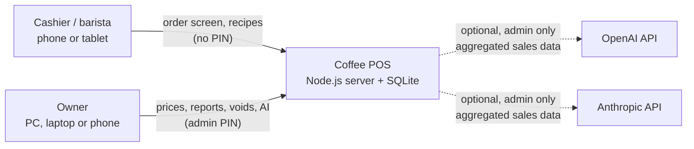

## 3. Components

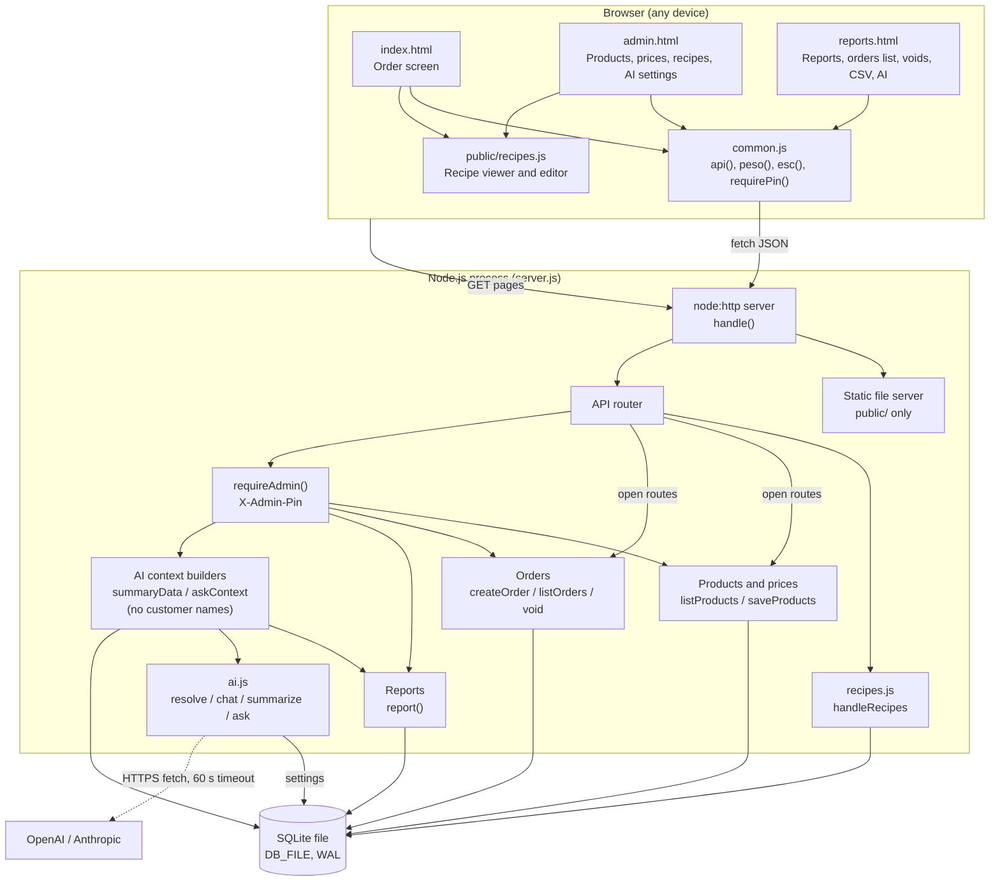

The order path (`index.html` → `GET /api/products`, `POST /api/orders`, `GET /api/recipes/:id`) has no edge to `ai.js` or the internet. Keep it that way.

### Module boundaries

- `server.js` owns the database handle and shared helpers and passes them to feature modules. A feature that grows gets its own module with a small hook, as `recipes.js` does with `setupRecipes(db, helpers)` returning a handler that answers `true` when it handled the request.
- `ai.js` has no database access. It receives a resolved config and plain data objects and returns text, so what reaches the provider is decided entirely in `server.js` (`summaryData`, `askContext`).
- Browser pages share only `common.js`, `recipes.js` and `app.css`; each page's logic is inline in its HTML.

## 4. Request pipeline

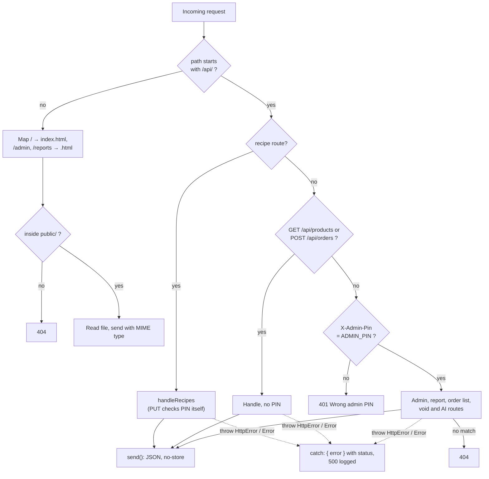

## 5. Data architecture

The full schema and column notes are in [SYSTEM_SPEC.md §5](SYSTEM_SPEC.md#5-data-model). Architecturally the tables split in two:

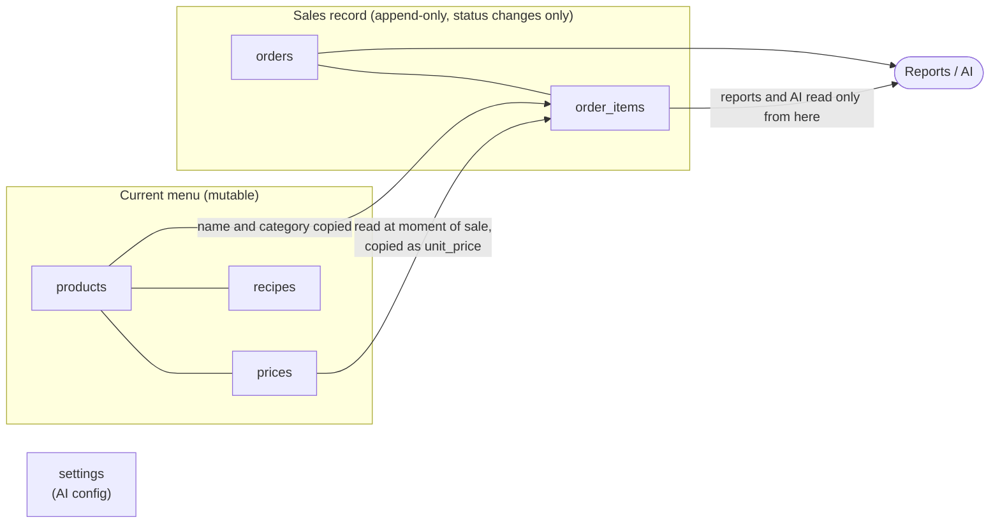

- **Snapshots, not joins.** Nothing in reports joins back to `products` or `prices`, so price edits, hides and deletes never change history.
- **Period by prefix.** `created_at` is local-time text; a day, month or year is a `LIKE 'prefix%'` range scan on `idx_orders_created`.
- **Migrations are start-up DDL.** `CREATE TABLE IF NOT EXISTS` on every start; changes must be additive.
- **Concurrency.** One process and a synchronous driver mean writes are serialised by the event loop. WAL lets reads proceed while a write commits. Every multi-row write is one `BEGIN … COMMIT` with no `await` inside it.

## 6. Key flows

### 6.1 Taking an order

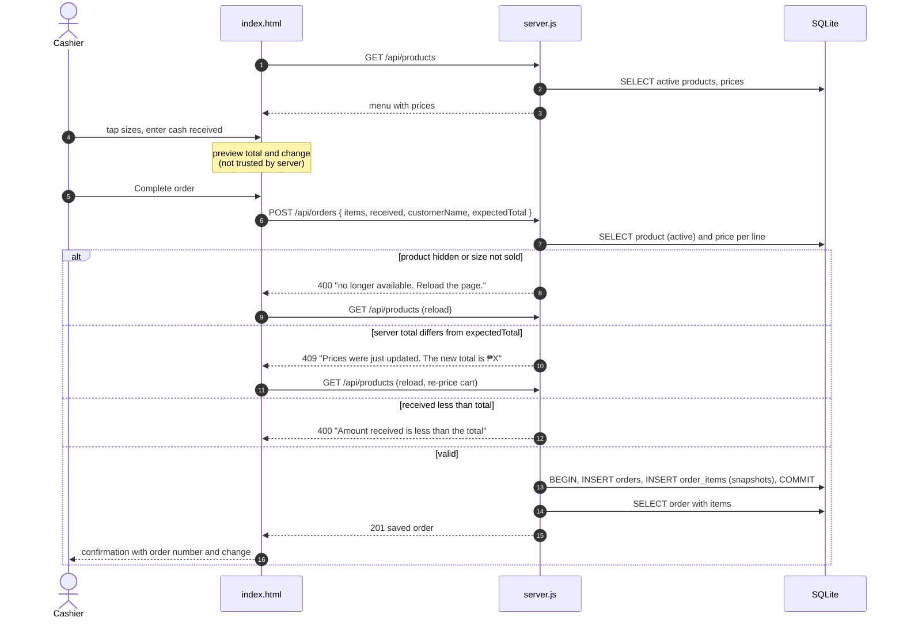

### 6.2 Changing prices while counters are open

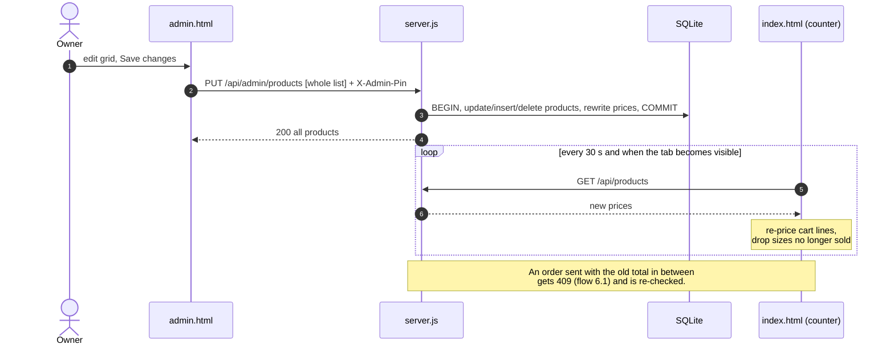

### 6.3 Admin unlock and a report

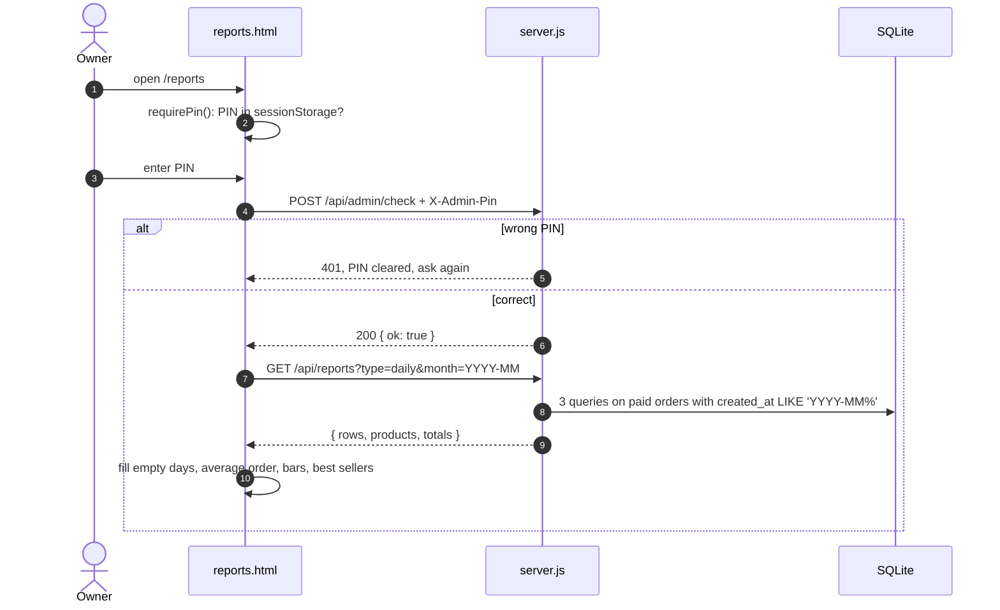

### 6.4 Voiding an order

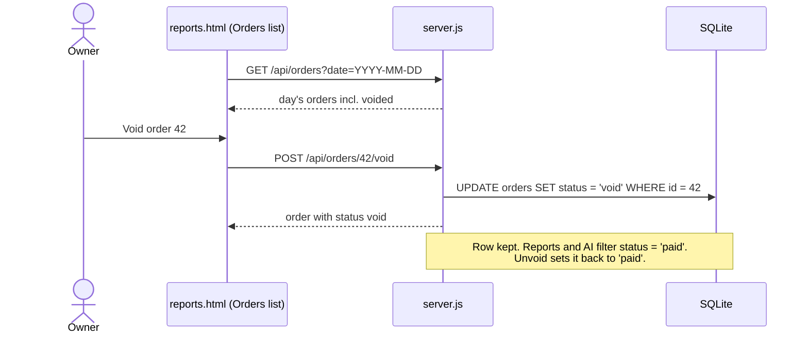

### 6.5 AI summary (optional)

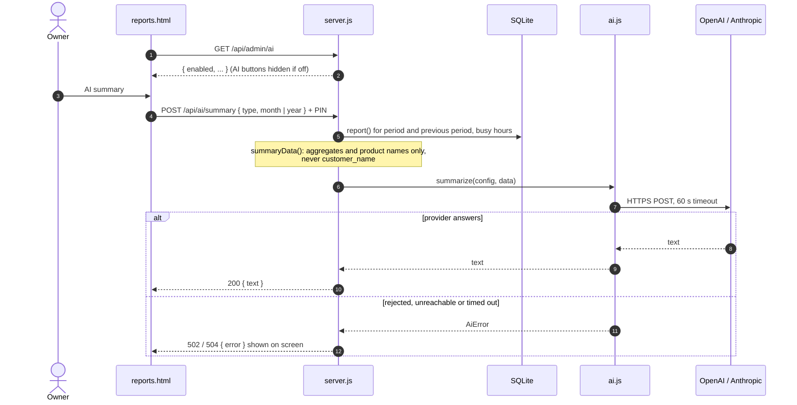

"Ask about your sales" (`POST /api/ai/ask`) follows the same path with `askContext()` and up to 6 earlier messages.

### 6.6 Start-up

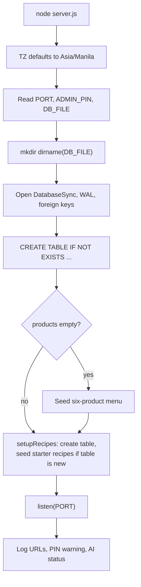

## 7. Deployment

The same build runs on a shop computer or on Railway. Only environment variables differ.

### 7.1 Shop LAN

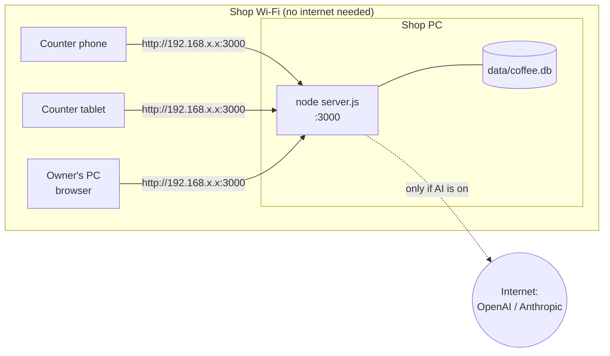

### 7.2 Railway (current hosting)

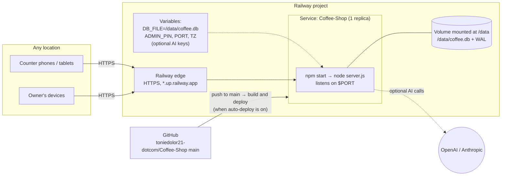

Railway settings live in the Railway dashboard, not in the repo (no `railway.json`, `Dockerfile` or `Procfile`).

| Setting | Value | Why |
| --- | --- | --- |
| Start command | `npm start` (detected from `package.json`) | Runs `node server.js` |
| Node version | 22.13 or newer | `node:sqlite` without a flag; set by `engines.node` |
| Volume | Mounted at `/data` | The container file system is wiped on every deploy |
| `DB_FILE` | `/data/coffee.db` | Puts the database, WAL and SHM files on the volume |
| `TZ` | `Asia/Manila` | Containers default to UTC; the code also defaults it, but set it explicitly |
| `ADMIN_PIN` | Long, private value | The URL is public; there is no lockout on wrong PINs |
| `PORT` | Set by Railway | The server reads it; no host binding needed |
| Replicas | Exactly 1 | SQLite has one writer, and a volume attaches to one service instance |

Operational consequences of hosting:

- **Internet becomes a hard dependency** for the counters. If the shop's connection drops, orders stop. Running locally on the LAN is the fallback; the two databases are separate files and do not sync.
- **Deploys restart the process.** Expect a short outage on each deploy; avoid deploying during opening hours. Committed orders are safe on the volume.
- **Backups** are the volume's (Railway volume backups) or a copy of `/data/coffee.db` taken while the service is stopped.
- **Do not scale out.** More replicas would either fail to mount the volume or each get their own database.
- **No health check endpoint.** If one is configured, `GET /api/products` is a suitable path.
- The start-up log's "Other devices on the same Wi-Fi" line shows container addresses on Railway and can be ignored.

## 8. Cross-cutting concerns

| Concern | Approach |
| --- | --- |
| Error handling | Handlers throw `HttpError(status, message)`; one `catch` in `createServer` turns it into `{ error }`. Unknown errors are logged and returned as `500 "Server error"`. Messages are written for staff. |
| Money | Floating-point `REAL`, rounded with `money()` at every server-side calculation; shown with `peso()` (`en-PH`). |
| Time | Process `TZ` decides order timestamps and report periods. The reports page derives "today" from the browser clock. |
| Offline | No external assets. The only outbound calls are in `ai.js`. |
| Privacy | Customer names stay in `orders`; AI receives aggregates. |
| Caching | API responses `Cache-Control: no-store`. Static files have no caching headers. |
| Observability | Start-up log and 500 errors to stdout/stderr (Railway's log view). No request log or metrics. |
| Testing | No automated tests. Manual checks against a throwaway `DB_FILE`. |

## 9. Extension points and limits

- **New feature module:** follow `recipes.js`: `setupX(db, helpers)` creates its tables additively and returns a handler, called from `handle()` before or after `requireAdmin` depending on whether it needs the PIN.
- **New report:** add a query on `orders`/`order_items` filtered by `status = 'paid'` and a `created_at` prefix; never read `prices`.
- **New AI data:** add it in `summaryData()`/`askContext()` only, as aggregates without `customer_name`.
- **New AI provider:** add an entry to `ai.js` `PROVIDERS` and a branch in `chat()`; settings keys follow `ai_<id>_key` / `ai_<id>_model`.
- **Limits of this design:** one shop and one server; one shared PIN; no offline mode on client devices; no audit log. The PRD's future-ideas table covers which of these to address and in what order.
