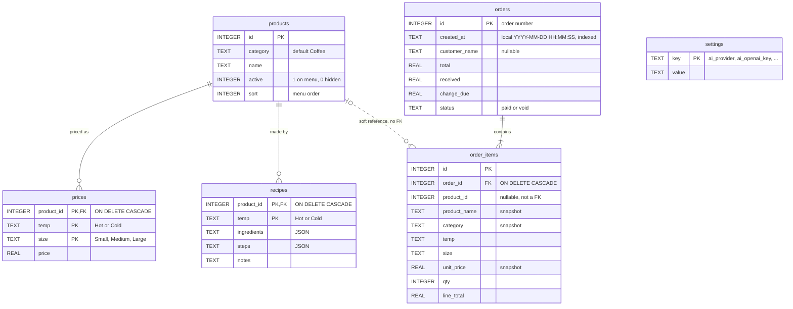

# Coffee POS: System Specification

Technical specification of the Coffee POS as built on `main`. It describes *how* the system meets the product requirements; it does not restate them.

| Document | Covers |
| --- | --- |
| `Coffee POS Product Requirements Document (updated).pdf` (the PRD) | What the product does and why: users, scenarios, requirement IDs (`OR-*`, `AD-*`, `RP-*`, `OL-*`, `RC-*`, `AI-*`), business rules, roadmap |
| `CLAUDE.md` / `.cursorrules` | Rules and conventions for changing the code |
| **This file** | Runtime, configuration, modules, data model, API contract, validation, security and operational behaviour |
| [`ARCHITECTURE.md`](ARCHITECTURE.md) | Components, data flow, request sequences and deployment, with diagrams |

Requirement IDs from the PRD are quoted in brackets, e.g. [OR-12], where this spec implements them.

---

## 1. Runtime and constraints

| Item | Value |
| --- | --- |
| Runtime | Node.js **22.13 or newer** (`package.json` `engines.node: ">=22.13"`) |
| Server | `node:http`, single process, single thread |
| Database | `node:sqlite` `DatabaseSync` (synchronous), one file, WAL journal, foreign keys on |
| Outbound HTTP | Global `fetch`, used only by `ai.js` |
| Dependencies | None. No `node_modules`, no build step, no bundler, no framework |
| Client | Plain HTML pages with inline `<script>`, shared `common.js`, `recipes.js`, `app.css` |
| Module system | CommonJS |
| Start | `node server.js`, `npm start`, or `start-windows.bat` |

Design constraints that every change must keep (from `CLAUDE.md`):

1. The order path (`/`, `GET /api/products`, `POST /api/orders`) never touches `ai.js` or any outside service.
2. Prices are read on the server at the moment of sale and snapshotted on each order line.
3. No remote assets: no CDNs, fonts, analytics. Everything is served from `public/`.
4. No new npm dependencies without the owner's approval.
5. No data, database files, keys or a real PIN in git.
6. Customer names are never sent to an AI provider.
7. Money is rounded to 2 decimals on the server with `money()`.
8. Voided orders stay in the database and are filtered out with `status = 'paid'`.
9. User text is escaped with `esc()` before it is put in HTML.

## 2. Deployment targets

The same code runs in two ways. Nothing in the code branches on which one is used; only environment variables differ.

| | Shop LAN (original) | Railway (current hosted) |
| --- | --- | --- |
| Host | Shop PC or laptop | Railway service, one instance |
| Reached at | `http://<LAN-IP>:3000` | Railway HTTPS domain (TLS ends at Railway's edge) |
| Database | `./data/coffee.db` | Railway volume mounted at `/data`, `DB_FILE=/data/coffee.db` |
| Internet needed | No (only for the optional AI) | Yes, for every device |
| Start | `node server.js` / `start-windows.bat` | Railway runs `npm start` → `node server.js` |
| Port | `PORT` or 3000 | `PORT` injected by Railway |

Railway is configured in the Railway dashboard. The repo has no `railway.json`, `Dockerfile` or `Procfile`; the builder detects `package.json`, uses its `start` script, and should pick Node from `engines.node`. See [ARCHITECTURE.md §7](ARCHITECTURE.md#7-deployment) for the diagram and the operational caveats.

## 3. Configuration

All configuration is environment variables, read once at startup. AI settings saved on the admin page (in the `settings` table) win over the AI environment variables.

| Variable | Default | Read in | Effect |
| --- | --- | --- | --- |
| `PORT` | `3000` | `server.js` | HTTP listen port. Railway sets it. |
| `ADMIN_PIN` | `1234` | `server.js` | Value the `X-Admin-Pin` header must equal. The server logs a warning on start while it is `1234`. |
| `TZ` | `Asia/Manila` | `server.js` (first line sets `process.env.TZ` if unset) | Time zone for order timestamps and report periods. **Set it explicitly on Railway**, whose containers run in UTC. |
| `DB_FILE` | `<app>/data/coffee.db` | `server.js` | SQLite file path. The parent directory is created if missing. On Railway: `/data/coffee.db` on the volume. |
| `AI_PROVIDER` | auto | `ai.js` | `openai`, `anthropic` (alias `claude`) or `off`. Auto picks OpenAI if an OpenAI key exists, else Anthropic if its key exists, else OpenAI (disabled). |
| `OPENAI_API_KEY` | none | `ai.js` | OpenAI key, used if no key is saved in settings |
| `ANTHROPIC_API_KEY` | none | `ai.js` | Anthropic key, used if no key is saved in settings |
| `AI_MODEL` | provider default | `ai.js` | Model override; defaults are `gpt-5-mini` and `claude-haiku-5-5` (`ai.js` `PROVIDERS`) |

Precedence for each AI value: saved setting `ai_<name>` → environment variable → built-in default.

## 4. Modules

| File | Responsibility | Exposes / hooks |
| --- | --- | --- |
| `server.js` | Opens the DB, creates schema, seeds menu, helpers (`money`, `localNow`, `HttpError`, `send`, `readJson`, `requireAdmin`), products, orders, reports, AI context builders, routing, static files, startup log | Entry point |
| `recipes.js` | `recipes` table, one-time starter seed, recipe validation, `/api/recipes/:id` and `/api/admin/recipes/:id` | `setupRecipes(db, helpers)` returns `handleRecipes(req, res, url)`, which returns `true` when it answered |
| `recipes-seed.js` | Placeholder recipes for the six starting products, keyed by product name | Plain object |
| `ai.js` | Provider table, config resolution, key masking, HTTP calls to OpenAI / Anthropic, prompt text, `summarize`, `ask` | `PROVIDERS, AiError, resolve, maskKey, chat, summarize, ask` |
| `public/common.js` | `api()` fetch wrapper (adds `X-Admin-Pin` from `sessionStorage`), `peso()`, `esc()`, `$()`, `toast()`, `header()`, `requirePin()` | Globals |
| `public/index.html` | Order screen | Uses `/api/products`, `/api/orders`, `/api/recipes/:id` |
| `public/admin.html` | Products & prices grid, recipe editor, AI settings | Uses `/api/admin/*` |
| `public/reports.html` | Daily / Monthly / Annual reports, Orders list, void, CSV, print, AI summary and Q&A | Uses `/api/reports`, `/api/orders`, `/api/orders/:id/(void\|unvoid)`, `/api/ai/*` |
| `public/recipes.js` | Recipe viewer and editor dialogs | Globals |
| `public/app.css` | Shared styles, print rules | |

## 5. Data model

One SQLite file. Schema is created with `CREATE TABLE IF NOT EXISTS` at every start, so starting the server is also the migration. The PRD lists the columns; the points below are the technical details that matter when changing the code.



Technical notes:

- **Menu vs. sales record.** `products`, `prices`, `recipes` describe the current menu and can change at any time. `orders` and `order_items` are the permanent record. `order_items.product_id` is deliberately **not** a foreign key, so deleting a product never touches past sales; reports group by the snapshotted `product_name`.
- **Timestamps as local text.** `created_at` is produced by `localNow()` from the process clock in `TZ`. Reports select periods by string prefix (`LIKE 'YYYY-MM%'`) and group by `substr(created_at, 1, n)`, which uses `idx_orders_created`. Changing `TZ` changes how *new* orders are stamped, not old ones.
- **Prices as REAL.** Money is stored as floating point and rounded with `money(n) = round(n × 100) / 100` at every write and every sum the server returns.
- **Price availability.** A missing `prices` row means that temp/size is not sold. `saveProducts` deletes and rewrites a product's price rows on every save.
- **Seeding.** The six-product menu is inserted when `products` is empty [AD-9]. Starter recipes are inserted only in the same start-up that first creates the `recipes` table, matched to products by name (case-insensitive) [RC-5].
- **Settings keys.** `ai_provider`, `ai_openai_key`, `ai_openai_model`, `ai_anthropic_key`, `ai_anthropic_model`. Empty values delete the row.
- **Schema changes** must be additive (new tables, or nullable / defaulted columns guarded so start-up works on old and new files). Existing sales rows are never rewritten.

## 6. HTTP API

JSON over HTTP. Request bodies are JSON, capped at 1 MB (`413`). All API responses are `application/json` with `Cache-Control: no-store`. Errors are `{ "error": "<plain-English message>" }`.

### 6.1 Routing order

`handle()` in `server.js` checks routes in this order. The order is what defines which routes need the PIN.

1. Path does not start with `/api/` → static file.
2. `handleRecipes` (recipe routes, which check the PIN themselves for `PUT`).
3. `GET /api/products`, `POST /api/orders` (open).
4. `requireAdmin(req)`: every other `/api/*` route below this line needs the PIN, **including unknown ones**, so an unknown API path without a PIN returns `401`, with a PIN `404`.

### 6.2 Endpoints

| Method | Path | PIN | Request | Response |
| --- | --- | --- | --- | --- |
| GET | `/api/products` | No | | `200` `[{ id, category, name, active, sort, prices: { "Hot\|Small": 60, ... } }]`, active only, by `sort, id` |
| POST | `/api/orders` | No | `{ items: [{ productId, temp, size, qty }], received, customerName?, expectedTotal? }` | `201` saved order with `items` |
| GET | `/api/recipes/:productId` | No | | `200` `{ Hot?: Recipe, Cold?: Recipe }` |
| PUT | `/api/admin/recipes/:productId` | Yes | `{ Hot?: Recipe, Cold?: Recipe }` | `200` saved recipes |
| POST | `/api/admin/check` | Yes | | `200 { ok: true }` |
| GET | `/api/admin/products` | Yes | | `200` all products including hidden |
| PUT | `/api/admin/products` | Yes | Full list: `[{ id?, category, name, active, prices, deleted? }]`, array order = menu order | `200` all products after save |
| GET | `/api/orders?date=YYYY-MM-DD` | Yes | `date` defaults to today | `200` orders of that day, newest first, each with `items`, voided included |
| POST | `/api/orders/:id/void` | Yes | | `200` order with `status: "void"` |
| POST | `/api/orders/:id/unvoid` | Yes | | `200` order with `status: "paid"` |
| GET | `/api/reports?type=daily&month=YYYY-MM` | Yes | `month` defaults to current | `200` Report |
| GET | `/api/reports?type=monthly&year=YYYY` | Yes | `year` defaults to current | `200` Report |
| GET | `/api/reports?type=annual` | Yes | | `200` Report |
| GET | `/api/admin/ai` | Yes | | `200` AiStatus |
| PUT | `/api/admin/ai` | Yes | `{ provider?, openai_key?, openai_model?, anthropic_key?, anthropic_model? }`; omitted fields unchanged, `""` clears | `200` AiStatus |
| POST | `/api/admin/ai/test` | Yes | | `200 { text }` |
| POST | `/api/ai/summary` | Yes | `{ type, month?, year? }` | `200 { text }` |
| POST | `/api/ai/ask` | Yes | `{ question, history?: [{ role, content }] }` | `200 { text }` |
| GET | `/`, `/admin`, `/reports`, `/<file>` | No | | Static file from `public/` |

Types:

```text
Recipe   = { ingredients: [{ item, amounts: { Small?, Medium?, Large? } }], steps: [string], notes: string }
Report   = { type, prefix, rows: [{ period, orders, sales, cups }],
             products: [{ name, temp, size, qty, sales }],   // best sellers, sales desc
             totals: { orders, sales, cups } }
AiStatus = { enabled, provider, label, model, problem, savedProvider,
             keys: { openai|anthropic: { set, source: "saved"|"environment"|"", hint, model } },
             providers: { openai|anthropic: { label, defaultModel } } }
```

`Report.rows` holds only periods that have paid orders. `reports.html` fills in the empty days or months up to today [RP-3, RP-4] and computes the average order.

### 6.3 Status codes

| Code | When |
| --- | --- |
| 400 | Invalid JSON, empty order, bad quantity, short payment, unavailable product or size, bad date/month/year, unknown report type, invalid price or missing product name, invalid recipe, unknown AI provider, empty AI question, AI not set up |
| 401 | Missing or wrong `X-Admin-Pin` (`"Wrong admin PIN"`) |
| 404 | Unknown route, unknown order on void/unvoid, unknown product on a recipe route, missing static file (plain text) |
| 409 | `expectedTotal` differs from the server total [OR-12] |
| 413 | Body over 1 MB |
| 500 | Unexpected error (logged to the console; the client only sees `"Server error"`) |
| 502 / 504 | AI provider rejected, unreachable, out of credit, unknown model (502) or timed out after 60 s (504) |

## 7. Core processing rules

### 7.1 Creating an order (`createOrder`)

1. Reject if `items` is empty.
2. For each item: load the product **only if `active = 1`**, then its price for `temp`/`size`. Either missing → `400` "... no longer available. Reload the page."
3. `qty = floor(Number(qty))`, must be 1 to 999.
4. `line_total = money(price × qty)`, `total = money(Σ line_total)`. Browser prices are never read.
5. If `expectedTotal` was sent and `money(expectedTotal) ≠ total` → `409` with the new total.
6. `received = money(received)`, must be finite and `≥ total`; `change_due = money(received − total)`.
7. `customer_name` = trimmed, first 100 characters, or `NULL` if blank.
8. In one transaction: insert `orders` (status defaults to `paid`), then each `order_items` row with snapshotted name, category and unit price. `ROLLBACK` on error.
9. Return the order as read back from the database.

Validation runs before `BEGIN`, and nothing between `BEGIN` and `COMMIT` awaits, so on a single Node thread two orders can never interleave.

### 7.2 Saving products (`saveProducts`)

The admin page sends the whole list. In one transaction, for each row by index `i`: delete it if `deleted` (cascades to prices and recipes), otherwise require a name, update or insert it with `sort = i`, delete its price rows, and insert a row for every non-blank price that is a finite number `≥ 0` (rounded). Any error rolls back everything and names the row [AD-8, rule 9].

### 7.3 Reports (`report`)

| type | Filter prefix | Group length | Rows |
| --- | --- | --- | --- |
| `daily` | `YYYY-MM` | 10 | one per day |
| `monthly` | `YYYY` | 7 | one per month |
| `annual` | `''` (all) | 4 | one per year |

Every query filters `o.status = 'paid' AND o.created_at LIKE prefix || '%'`. Three queries run: orders and sales per period, cups (Σ `qty`) per period, and best sellers grouped by `product_name, temp, size`. Report figures come only from `orders` and `order_items`, never from `prices` [RP-8].

### 7.4 Void and unvoid

`UPDATE orders SET status = ? WHERE id = ?`. No rows are deleted. Voided orders still appear in `GET /api/orders` (the list), and are excluded from reports and AI data [OL-3].

### 7.5 Recipes

`PUT` replaces both temps of a product in one transaction. Input is cleaned: ingredient names up to 100 characters, amounts up to 60 per size, steps up to 500, notes up to 1,000, at most 50 ingredients and 50 steps per temp. An ingredient with amounts but no name is rejected. A temp with nothing in it is not stored.

### 7.6 AI assistant

- `resolve(settings)` returns `{ provider, label, key, keySource, model, enabled }`; `enabled` is `true` only when a key is present.
- `chat()` calls `https://api.openai.com/v1/chat/completions` (Bearer key) or `https://api.anthropic.com/v1/messages` (`x-api-key`, `anthropic-version: 2023-06-01`, `max_tokens: 1500`) with a 60-second `AbortSignal.timeout`. Provider failures become `AiError` with a staff-readable message.
- **Summary** sends `summaryData()`: the requested report, the previous period's totals and top 10 products (daily and monthly only), and orders per hour for daily reports.
- **Ask** sends `askContext()`: menu with prices, yearly and monthly totals, daily totals for the last 120 days, product sales by month for the last 13 months, and orders by weekday and hour for the last 120 days. The last 6 history messages are sent, each cut to 4,000 characters; the question is cut to 1,000.
- Neither builder selects `customer_name` [AI-6]. API keys are never returned to the browser, only `maskKey()` hints like `sk-…abcd`.

## 8. Client behaviour that the server relies on

| Behaviour | Where | Why it matters |
| --- | --- | --- |
| Reloads `/api/products` every 30 s and on `visibilitychange` | `index.html` | Price changes reach counters within 30 s [OR-11] |
| Re-prices cart lines and drops unsold ones after each reload | `index.html` | Keeps the preview total in step with the server |
| Sends `expectedTotal` with every order; on `409` or `400` reloads products | `index.html` | Detects mid-sale price changes [OR-12] |
| Disables Complete while a request is in flight (`saving` flag) | `index.html` | No double submits [OR-8] |
| PIN kept in `sessionStorage`, sent as `X-Admin-Pin`; cleared on `401` and on Lock | `common.js` | Per-tab admin session [AD-1] |
| CSV export escapes leading `= + - @` and quotes | `reports.html` | Prevents formula injection in Excel |
| "Today" for report pickers comes from the browser clock | `reports.html` | Matches the server only when the device and `TZ` agree |

## 9. Security model

| Concern | Current design |
| --- | --- |
| Authentication | One shared admin PIN, compared as a string on each request. No accounts, sessions or cookies. |
| Authorisation | Two levels: open (order screen, menu, recipes) and PIN (everything else). |
| Transport | Plain HTTP on the LAN. On Railway, HTTPS at the edge, HTTP to the container. |
| Input | All SQL uses prepared statements with `?`. Report period inputs are regex-checked before being used as `LIKE` prefixes; group lengths are constants. Bodies capped at 1 MB. |
| Output | All user text in HTML goes through `esc()`. |
| Static files | Path is normalised and must stay inside `public/`. |
| Secrets | AI keys live in `settings` or env vars only; the browser sees masked hints. `.gitignore` excludes `data/` and `*.db*`. |
| Privacy | Customer names stay in the database; AI receives aggregates only. |

Known gaps (no change in this document; listed so they are decided on purpose):

- **PIN guessing.** There is no rate limit or lockout on `/api/admin/check`. On a shop LAN this is low risk; on a public Railway URL a 4-digit PIN can be guessed in minutes. Use a long `ADMIN_PIN` there, and consider adding a lockout.
- **Open order endpoint.** On a public URL anyone who finds it can open the order screen and post orders. This is the PRD's open question about a cashier PIN.
- **No audit trail** for voids or price changes (PRD future idea).
- No security headers (CSP, `X-Frame-Options`) are set.

## 10. Operations

| Topic | Behaviour |
| --- | --- |
| Start-up | Create DB directory, open DB, create schema, seed if empty, set up recipes, listen, log LAN URLs, PIN warning and AI status |
| Logs | `console.log` on start; `console.error` for unexpected (500) errors only. No request log. |
| Health check | None dedicated. `GET /api/products` is cheap, open and touches the DB, so it works as one. |
| Backup | Copy the one `.db` file (with `-wal`/`-shm` if present), best while stopped. On Railway, use volume backups or copy the file out. |
| Restore | Stop, replace the file, start. |
| Reset | Delete the file; next start seeds the starting menu with no sales. |
| Shutdown | Process exit. Committed transactions are durable in WAL; no graceful-shutdown handler. |
| Scaling | One process, one writer. Must not run more than one instance against the same file. |
| Tests | None. Verify with a throwaway DB: `DB_FILE=/tmp/test.db PORT=3001 node server.js`, the pages, and `curl`. |
